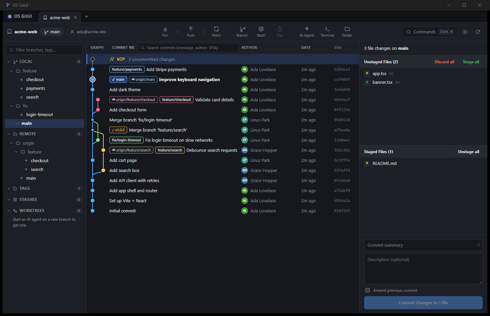

# OS GitUI

A free, open-source Git GUI for macOS, Linux and Windows.



Website: https://thinkelution.github.io/the-os-gitui/

## Features (v0.1)

- Commit graph with colored lanes, branch and tag badges, search, keyboard navigation
- Repository tabs; open, clone (with progress) or init a repo
- Stage, unstage and discard by file, hunk, or selected lines
- Unified and side-by-side diffs for working changes and commits
- Commit and amend
- Branches: create, switch, rename, delete, track remote branches
- Merge, rebase, cherry-pick, revert, reset (soft / mixed / hard)
- Fetch, pull (fast-forward / merge / rebase), push, force push with lease
- Tags: create, push, delete
- Stashes: push (with untracked), apply, pop, drop
- Abort / continue banner for merge, rebase, cherry-pick and revert
- Open from a terminal: `the-os-gitui path/to/repo`

## Stack

| Part | Choice |
|---|---|
| App shell | [Tauri 2](https://tauri.app) (Rust) |
| UI | React 18 + TypeScript + Vite, Zustand for state |
| Commit graph | Lane layout in Rust, drawn on a canvas with a virtual list |
| Git | The `git` CLI, so hooks, SSH keys, credential helpers and signing work as in a terminal |

## Develop

Needs Node 20+, Rust stable, and Git 2.31+. On Linux also install the
[Tauri system libraries](https://tauri.app/start/prerequisites/).

```sh
npm install
npm run tauri dev        # run the app with hot reload
npm test                 # UI tests
cargo test --manifest-path src-tauri/Cargo.toml   # Rust tests
npm run tauri build      # build installers for this OS
```

## Release

Push a tag such as `v0.1.0`. The `Release` workflow builds installers for macOS
(Apple Silicon and Intel), Windows and Linux, and creates a draft GitHub release.
Builds are not code-signed yet, so macOS and Windows show a warning on first open.

## Roadmap

- Interactive rebase
- Merge conflict editor
- File history and blame
- GitHub / GitLab pull requests
- AI layer: commit messages, diff explanations, coding agents on branches

## License

MIT
